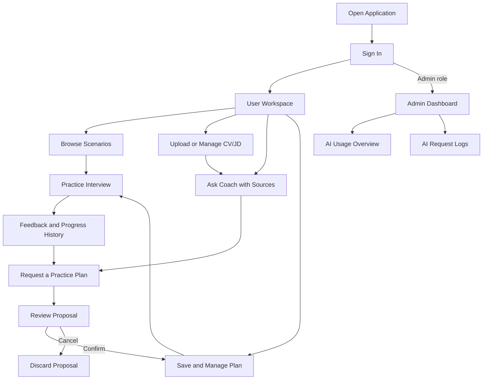

# InterviewAI — Detailed Presentation Content Plan

> Cập nhật: 26/10/2026, Asia/Saigon.
> Phạm vi: kế hoạch nội dung cho toàn project của Khoa, Long và Đức. PowerPoint draft được dựng theo plan tại `output/InterviewAI_Final_Project_Presentation_2026-10-26.pptx`.
> Slide dùng tiếng Anh. Phần giải thích, lời nói gợi ý và hướng dẫn chuẩn bị dùng tiếng Việt.
> Thứ tự đã chốt: Introduction → Outline → Overview → Application Flow → Responsibilities → Khoa → Long → Đức → Results & Conclusion.
> Deck dùng thứ tự trong file này thay cho thứ tự cũ của `FINAL_PROJECT_SLIDE_AND_REQUIREMENTS_GUIDE.md`.

## 1. Mục tiêu và nguyên tắc biên soạn

Người nghe cần hiểu hệ thống giải quyết vấn đề gì, người dùng thao tác thế nào, ba thành viên phụ trách gì, mỗi module hoạt động ra sao và nhóm có bằng chứng nào cho kết quả. Trình bày trực tiếp sản phẩm, không dùng nhân vật giả lập như An hoặc một câu chuyện ứng tuyển hư cấu.

Mỗi slide có hai lớp nội dung:

- **On-slide content:** nội dung tiếng Anh để đưa lên slide. Giữ câu ngắn, ưu tiên hình, sơ đồ và bảng có ít cột.
- **Explanation / speaker notes:** phần trình bày sâu hơn, quyết định thiết kế, tình huống lỗi, phạm vi kiểm chứng và đầu mối code. Phần này đi vào notes, report hoặc Q&A, không dồn hết lên màn chiếu.

Không dùng số lượng slide để kết luận công việc của từng người nhiều hay ít. Mỗi người có ba slide chính, còn slide phân công ghi đầy đủ nhiệm vụ theo PLAN. Đóng góp hỗ trợ tích hợp được ghi nhận riêng, không tự đổi module owner.

Các nội dung sau phải được phân biệt khi nói:

| Khái niệm | Cách trình bày đúng |
|---|---|
| Assigned scope | Nhiệm vụ theo `Image Task/PLAN (1).md`, không tự chứng minh đã hoàn thành |
| Implemented behavior | Hành vi có trong code hiện tại, cần ảnh/demo để chứng minh trải nghiệm thực tế |
| Recorded evaluation | Kết quả đã lưu trong repo, phải kèm model, ngày, dữ liệu và checker |
| Pending verification | Phần cần xác minh lại trước bảo vệ, không trình bày như đã pass |
| Runtime AI usage | Số request, token, cost, latency và lỗi của ứng dụng |
| Development AI usage | Nhật ký hỗ trợ lập trình trong `AI_USAGE.md`, không có slide riêng trong deck này |

## 2. Dàn 15 slide và thời gian dự kiến

| Slide | English title | Người trình bày | Thời gian |
|---|---|---|---:|
| 01 | InterviewAI: AI-Assisted Interview Practice | Người mở đầu | 15 giây |
| 02 | Presentation Outline | Người mở đầu | 10 giây |
| 03 | Project Overview & System Architecture | Người mở đầu | 30 giây |
| 04 | Application User Flow | Người mở đầu | 25 giây |
| 05 | Team Responsibilities | Người mở đầu, chuyển sang Khoa | 30 giây |
| 06 | Interview Practice & Progress History | Khoa | 35 giây |
| 07 | Structured Feedback & Deterministic Scoring | Khoa | 40 giây |
| 08 | AI Usage Dashboard & Evaluation | Khoa | 35 giây |
| 09 | Document Upload & Knowledge Preparation | Long | 35 giây |
| 10 | RAG Answers with Verifiable Sources | Long | 40 giây |
| 11 | Streaming, Guardrails & Privacy | Long | 35 giây |
| 12 | Authentication & Access Control | Đức | 30 giây |
| 13 | Tool-Using Agent & Practice Plans | Đức | 45 giây |
| 14 | AI Logging, Provider Fallback & Deployment | Đức | 40 giây |
| 15 | Results, Limitations & Conclusion | Người kết thúc | 35 giây |
| | **Total** | | **480 giây / 8 phút** |

Đây là ngân sách cho cả phần trình bày và thao tác minh họa ngắn nếu hội đồng giữ mốc demo 8 phút. Không cộng thêm một lượt demo dài sau 15 slide. Có thể chuyển nhanh sang app ở slide 7, 10 hoặc 13, hoặc dùng clip đã cắt ngắn. Nội dung sâu bên dưới dùng để chuẩn bị lời nói và Q&A, không đọc hết trong 8 phút.

## 3. Nội dung chi tiết từng slide

### Slide 01 — InterviewAI: AI-Assisted Interview Practice

**Mục tiêu:** giới thiệu rõ tên sản phẩm, mục đích và nhóm thực hiện.

**On-slide content — English:**

> **InterviewAI**
>
> **AI-Assisted Interview Practice**
>
> Practice interviews, review feedback, and plan your next sessions.
>
> Team: [Full name — Khoa], [Full name — Long], [Full name — Đức]
>
> [Course] · [Class] · [Lecturer] · [Presentation date]

**Giải thích / speaker notes:**

“Nhóm em xây dựng InterviewAI, một web application hỗ trợ luyện phỏng vấn. Hệ thống kết hợp buổi luyện theo kịch bản, nhận xét có cấu trúc, hỏi đáp dựa trên tài liệu và lập kế hoạch có xác nhận. Ba phần AI được tích hợp vào cùng một ứng dụng.”

**Hình và bố cục:** tên sản phẩm lớn ở trái, một ảnh feedback hoặc Coach ở phải. Nền AI dạng lưới hoặc đường kết nối mờ ở mép, không chạy qua chữ.

**Placeholder cần điền:** `[Insert: school logo and a real InterviewAI product screenshot]`. Nhóm bổ sung họ tên, MSSV, môn học và logo chính thức. Không đặt API key, email riêng hoặc link chưa kiểm tra trên ảnh.

### Slide 02 — Presentation Outline

**Mục tiêu:** cho giảng viên biết hướng đi của báo cáo trước khi vào chi tiết.

**On-slide content — English:**

1. Project overview and application flow
2. Team responsibilities
3. Khoa: interview practice, feedback, and evaluation
4. Long: documents, RAG, and AI safety
5. Đức: authentication, agent, and reliability
6. Results, limitations, and conclusion

**Giải thích / speaker notes:**

“Nhóm giới thiệu kiến trúc và luồng sử dụng trước. Sau phần phân công, mỗi thành viên giải thích module mình phụ trách, cách kiểm chứng và những giới hạn. Cuối cùng là kết quả chung của hệ thống.”

**Hình và bố cục:** mục lục bằng sáu dòng dễ đọc, đánh dấu ba khối thành viên bằng một màu nhấn nhất quán. Không cần ảnh minh họa hoặc một slide chia chương riêng.

### Slide 03 — Project Overview & System Architecture

**Mục tiêu:** giải thích sản phẩm và stack bằng một sơ đồ dễ đọc, đồng thời đáp ứng yêu cầu architecture diagram.

**On-slide content — English:**

> **Purpose:** Help users practice interviews and turn feedback into a practice plan.
>
> **Users:** Interview candidates and administrators.
>
> **AI capabilities:** Structured feedback, retrieval-augmented generation, and tool-using agent.

**Nhãn tiếng Anh dùng trong sơ đồ:**

```text
React + Vite Frontend
       │ HTTPS requests with JWT
       ▼
Node.js + Express Backend
       ├── Supabase Auth
       ├── Supabase Postgres
       │      ├── Sessions, profiles, plans, pending actions
       │      ├── pgvector document chunks
       │      └── AI request logs
       ├── Private Supabase Storage
       └── AI Providers
              ├── Local Gemma through LM Studio
              └── Gemini generation fallback and embeddings
```

**Giải thích / speaker notes:**

- Frontend cung cấp giao diện luyện tập, tài liệu, Coach, kế hoạch và quản trị. Backend xác thực, kiểm tra quyền, xử lý nghiệp vụ và điều phối AI.
- Auth, Storage và Postgres là các thành phần riêng trong hệ Supabase. pgvector nằm trong Postgres, không phải một database độc lập.
- Luồng một câu hỏi: frontend gửi message/JWT, backend xác thực, tìm context nếu cần, gọi provider, kiểm tra kết quả, trả text/sources hoặc proposal và ghi log metadata.
- ADR mới chọn thứ tự provider local rồi Gemini. Đây là khả năng cấu hình theo repo; model thực tế khi bảo vệ phải lấy từ config/log của môi trường demo. Embeddings trong cấu hình local-first được ghi nhận vẫn dùng Gemini.
- Ngân hàng scenario hiện đọc từ dữ liệu repo. Không vẽ một module CRUD scenario trong DB nếu code chưa có.

**Hình cần dựng:** `[Insert: editable system architecture diagram with one highlighted AI request path]`. Có đường phản hồi từ backend tới frontend và đường ghi log. Giữ model ID đầy đủ ở notes thay vì kéo dài tên mỗi node.

**Nguồn:** `README.md`, `backend/src/services/llmProviders.js`, `backend/src/services/embeddingService.js`, `docs/adr/0003-local-model-first-with-cloud-fallback.md`.

### Slide 04 — Application User Flow

**Mục tiêu:** người nghe hiểu những gì có thể làm sau khi mở web, trước khi nghe phân công và chi tiết module.

**On-slide content — English:**

> **Open the application and sign in**
>
> **User workspace:** Practice interviews, manage documents, ask Coach, and manage practice plans.
>
> **Admin workspace:** Review AI usage metrics and request logs.

**Sơ đồ cần dựng:**



**Giải thích / speaker notes:**

- Người dùng không bắt buộc upload CV/JD trước khi luyện. Có thể chọn bài luyện ngay, tải tài liệu riêng hoặc hỏi Coach tùy mục đích.
- Scenario browse có tìm kiếm metadata, filter, sort và phân trang. Sau buổi luyện, người dùng xem feedback và tiến độ.
- Coach dùng tài liệu khi có nguồn phù hợp và dùng tool khi yêu cầu liên quan dữ liệu hoặc kế hoạch. Kế hoạch cũng có thể được quản lý thủ công.
- Admin là nhánh được cấp quyền riêng, không phải bước tiếp theo mà mọi user đều đi qua. Tài khoản admin có thể vẫn dùng các chức năng user.

**Hình và bố cục:** sơ đồ một trang, luồng User ở giữa và Admin ở cạnh phải. Có vòng quay lại luyện từ Plans. Dùng mũi tên cho quan hệ luồng thực tế, không xếp mọi trang thành chuỗi bắt buộc.

**Placeholder:** `[Insert: application user flow diagram with User and Admin branches]`.

### Slide 05 — Team Responsibilities

**Mục tiêu:** thể hiện đầy đủ phạm vi được giao theo PLAN mà vẫn đọc được trên màn chiếu.

**On-slide content — English:**

| Member | User stories | Assigned modules |
|---|---|---|
| **Khoa** | US-03, 04, 05, 13 | Interview persistence and history. Structured feedback and prompts. Admin dashboard, evaluation, architecture, and slides. |
| **Long** | US-06, 07, 08, 09 | CV/JD upload and deletion. RAG and citations. Streaming, input guardrails, and privacy. |
| **Đức** | US-01, 02, 10, 11, 12 | Supabase setup and authentication. Agent and practice plans. AI logging, fallback, and deployment setup. |

> **Shared work:** User stories, traceability, module ADRs, AI usage records, project report, and demo preparation.

**Chi tiết đầy đủ theo PLAN để đưa vào notes/report:**

| Thành viên | Nhiệm vụ và đầu ra được giao |
|---|---|
| Khoa | Chuyển interview/session và các service liên quan sang Supabase, dùng async; giữ nghiệp vụ luyện và chấm điểm đang có. |
| Khoa | Structured critique: JSON schema, `generateJson`, kiểm tra kết quả, UI feedback và fallback khi output lỗi. |
| Khoa | Prompt files và registry có tên/phiên bản; lịch sử có search/filter/sort/pagination theo US-05. |
| Khoa | Admin usage dashboard, tổng hợp cost/latency; khung evaluation và case capability C. |
| Khoa | Architecture diagram, slide tối đa 15; ADR model choice và nguyên tắc LLM không quyết định điểm rubric. Quyết định model được cập nhật bởi ADR 0003 sau PLAN gốc. |
| Long | RAG: ingest, chunk, embedding, retrieval, dữ liệu vector, nguồn riêng của user và nguồn question bank dùng chung. |
| Long | Upload CV/JD vào private Storage; danh sách, xem nội dung trích xuất, xóa file và dữ liệu truy hồi liên quan. |
| Long | Streaming SSE, trạng thái giao diện và điều khiển dừng. Guardrail injection/ngoài phạm vi. |
| Long | Evaluation cho RAG có nguồn/không có dữ liệu/không lộ dữ liệu, injection và ngoài phạm vi. |
| Long | Privacy: dữ liệu nào được gửi đến provider. ADR chunk size, top-k và lựa chọn pgvector. |
| Đức | Dựng Supabase, migrations, profiles/trigger; Google OAuth, JWT, role middleware và frontend auth state. |
| Đức | Agent và tool calling, pending actions, Confirm/Cancel, kiểm tra owner, expiry và thao tác ghi. |
| Đức | CRUD practice plans/items và giao diện quản lý kế hoạch. |
| Đức | Log request AI dùng chung, AI health/banner và fallback. Evaluation agent/fallback. |
| Đức | Deployment setup Render/Vercel/Supabase, README chạy app/env/test account; ADR tool confirmation và Supabase. |
| Cả nhóm | Mỗi người viết stories, traceability, AI_USAGE và ADR module mình. Mỗi người viết report, Đức gộp. Cùng làm video 3–5 phút và luyện bảo vệ. |

**Giải thích / speaker notes:**

“Đây là phân công theo kế hoạch, không phải bảng khẳng định mọi acceptance criterion đã hoàn thành. Khi tích hợp, các thành viên có hỗ trợ code của nhau; report sẽ ghi nhận bằng commit và phạm vi thực tế. US-14 về audio qua Gemini là hạng mục tùy chọn, không có owner bắt buộc và không nằm trong ba capability đã chọn.”

**Hình và bố cục:** bảng ba hàng lớn. Bảng chi tiết phía trên là notes, không đặt nguyên lên slide. Có thể dùng ba cột tên người và nhóm nhiệm vụ nếu bảng quá dày.

**Nguồn:** `Image Task/PLAN (1).md`, mục 3, 4 và 5. Chuyển lời cho Khoa ở cuối slide.

### Slide 06 — Interview Practice & Progress History

**Owner theo PLAN:** Khoa. **Stories:** US-03, US-05.

**On-slide content — English:**

- Find scenarios by role, level, and question type.
- Answer interview questions using speech or text.
- Save sessions, review scores, and track progress.

> **Scenario browsing:** Search, filters, sorting, and eight scenarios per page.

**Giải thích chi tiết:**

- Scenario search dùng tên scenario, ngành/vị trí, cấp độ và loại câu hỏi. Không tìm trong nội dung câu hỏi phỏng vấn.
- Sort theo tên A–Z, Z–A hoặc số câu hỏi. Khi thay từ khóa/filter/sort, quay về trang đầu. Endpoint browse riêng giữ luồng Plan/Coach lấy đủ scenario.
- Session có trạng thái, các turn/câu trả lời và kết quả. Dữ liệu được lưu theo user trong môi trường Supabase.
- Progress hiện có lịch sử các buổi đã chấm, biểu đồ điểm và tiêu chí yếu. Người dùng mở lại feedback của một buổi.
- **US-05 theo PLAN còn yêu cầu tìm/lọc/sort/phân trang lịch sử session.** Trong checkout đã đọc, `DashboardPage.jsx` hiện render progress/history và không có bộ điều khiển browse đầy đủ. Không lấy tìm kiếm scenario để nhận là đã hoàn thành US-05.
- Web Speech API là khả năng trình duyệt. Không dùng nó làm bằng chứng capability D về audio do model xử lý.

**Lời thuyết trình gợi ý:**

“Phần đầu là luồng luyện phỏng vấn. Người dùng tìm scenario phù hợp, trả lời bằng giọng nói hoặc văn bản và xem kết quả được lưu. Trang tiến độ cho phép xem các buổi trước và xu hướng điểm. Tìm kiếm scenario đã có phân trang riêng; yêu cầu nâng cao cho lịch sử session được theo dõi thành một phạm vi khác.”

**Ảnh cần bổ sung:** `[Insert: scenario search with filters and pagination]` là ảnh chính; `[Insert: completed session history and score trend]` là ảnh phụ hoặc notes. Không thu nhỏ cả ba trang lên cùng slide.

**Nguồn:** `backend/src/routes/scenarios.js`, `backend/src/services/scenarioService.js`, `backend/src/services/sessionService.js`, `frontend/src/pages/DashboardPage.jsx`.

### Slide 07 — Structured Feedback & Deterministic Scoring

**Owner theo PLAN:** Khoa. **Story:** US-04. **AI capability C:** Structured output.

**On-slide content — English:**

- Rubric rules calculate interview scores.
- AI reviews covered points, missing points, and improvement suggestions.
- Schema validation checks output before it is used.
- A basic review keeps feedback available when AI fails.

**Sơ đồ nhỏ:** `Question + reference points + user answer` → `Versioned prompt` → `AI JSON` → `Validation and grounding checks` → `Feedback UI`.

**Giải thích chi tiết:**

- JSON schema hiện gồm `coveredPoints`, `missingPoints`, `strengths`, `suggestion`, `improvedAnswer` và `onTopic`. Giới hạn độ dài và số mục để UI/DB không nhận output tùy ý.
- Prompt được lưu có version để so sánh trước/sau và truy lại bản đã dùng trong log/evaluation.
- Backend kiểm tra danh sách điểm và nội dung theo dữ liệu câu hỏi. Kiểm tra overlap giúp loại một số câu trả lời cải tiến thiếu căn cứ, nhưng không chứng minh đầy đủ tính đúng ngữ nghĩa.
- Rubric scoring là hàm xác định trong code. AI đưa nhận xét để người dùng cải thiện, không trực tiếp sửa điểm.
- Review chạy bất đồng bộ. Khi Finish, có giới hạn chờ; UI nhận trạng thái critique còn pending và có thể cập nhật review đến muộn.
- Sai JSON hoặc provider lỗi có retry/fallback theo luồng hiện tại. Nếu tất cả provider không tạo được kết quả hợp lệ, dùng scripted review.

**Quyết định thiết kế để giải thích:** dùng schema thay cho text tự do để có UI ổn định; tính điểm bằng code để kiểm tra và tái lập. Dẫn ADR “LLM does not score” và “grounding checks”.

**Lời thuyết trình gợi ý:**

“Capability C tạo feedback dưới dạng JSON có cấu trúc. Các trường được kiểm tra trước khi hiển thị, đồng thời có kiểm tra bám nguồn để hạn chế nội dung tự thêm. Điểm rubric vẫn do code tính nên cùng đầu vào cho cùng điểm khi bật hoặc tắt model. Nếu review chưa sẵn sàng hoặc AI lỗi, người dùng vẫn nhận được kết quả cơ bản.”

**Ảnh cần bổ sung:** `[Insert: feedback showing rubric scores and structured review fields]`. Khoanh vùng score, covered/missing points và suggestion; dùng cùng session với slide 6.

**Nguồn:** `backend/src/services/critiqueService.js`, `backend/src/schemas/critique.js`, `backend/src/services/scoringService.js`, `backend/src/prompts/`, `docs/adr/0001-llm-does-not-score.md`, `docs/adr/0002-grounding-checks-on-model-output.md`.

### Slide 08 — AI Usage Dashboard & Evaluation

**Owner theo PLAN:** Khoa. **Story:** US-13. Có đóng góp triển khai/tích hợp dashboard và log từ Đức, đối chiếu commit khi ghi report.

**On-slide content — English:**

> **Monitor:** Requests, input/output tokens, estimated cost, average latency, failures, and refusals.
>
> **Inspect:** Request logs by model, capability, status, and date.
>
> **Evaluate:** Versioned prompts and repeatable checks.
>
> **Recorded critique run:** 24/24 passed runs, eight cases repeated three times, local Gemma, 26 Oct 2026.

**Giải thích chi tiết:**

- Dashboard đọc số liệu tổng hợp từ bảng log chung, không sử dụng số demo viết cứng. Overview có period 7/30/90 ngày và biểu đồ request theo ngày.
- Cost là ước tính theo model và usage biết được. Request không có giá/usage phải thể hiện unknown, không đổi thành miễn phí.
- Average latency hiện tổng hợp các AI operation trong kỳ. Không gọi đó là thời gian trả lời trung bình của Coach nếu chưa lọc đúng phạm vi.
- PLAN có yêu cầu p95 và các filter bổ sung; chỉ nhận đã có khi endpoint/UI thực sự cung cấp. Overview hiện đọc có average latency, chưa lấy đó làm bằng chứng p95.
- Evaluation dùng expected checks và runner có thể chạy lại. Báo cáo phải có case normal/edge/refuse, model, prompt version, ngày và kết quả.
- Kết quả critique mới lưu: local `gemma-4`, prompt v2, 8 case × 3 lần = 24/24, average recorded latency 8,767 ms. Đây là số của suite này, không phải dashboard tổng hợp hoặc SLA sản phẩm.
- Before/after lịch sử có 19/24, 21/24 và 24/24. Nếu vẽ biểu đồ, ghi rõ thay đổi prompt/check/parser và không ghép model khác vào chuỗi như cùng điều kiện.

**Lời thuyết trình gợi ý:**

“Phần quản trị theo dõi số lần gọi, thời gian, chi phí ước tính và lỗi của AI. Bên cạnh vận hành, nhóm có bộ evaluation cho output có cấu trúc. Lần chạy được lưu ngày 26 tháng 10 đạt 24 trên 24 lượt kiểm tra của tám case, nhưng đây là bộ nhỏ với checker cụ thể, không đại diện cho độ chính xác trên mọi câu hỏi.”

**Ảnh cần bổ sung:** `[Insert: real admin overview with date range and cost coverage visible]`. Bên cạnh đặt một khung kết quả critique ngắn. Biểu đồ before/after và chi tiết JSON để trong notes/report nếu quá chật.

**Nguồn:** `frontend/src/pages/admin/AdminOverviewPage.jsx`, `AdminAiLogsPage.jsx`, `backend/src/routes/admin.js`, `supabase/migrations/20261026000100_admin_ai_usage_summary.sql`, `backend/eval/run.js`, `backend/eval/results/2026-10-26T04-42-27_critique_local_gemma-4_p2_local-first.json`.

### Slide 09 — Document Upload & Knowledge Preparation

**Owner theo PLAN:** Long. **Story:** US-06. **AI capability A:** đầu vào cho RAG.

**On-slide content — English:**

- Upload CVs and job descriptions to private storage.
- Extract text, split it into chunks, and create embeddings.
- Store searchable vectors with document ownership.
- Preview or delete documents and their related search data.

**Pipeline minh họa:** `PDF / DOCX / TXT / Markdown` → `Extract and validate` → `Chunk` → `Embed` → `Postgres + pgvector`.

**Giải thích chi tiết:**

- Có thư viện tài liệu dùng lại cho các buổi sau và tài liệu gắn với một session. Hai phạm vi cần được trình bày rõ.
- Code hiện giới hạn file 5 MB, text trích xuất 100,000 ký tự, tối đa 40 searchable chunks; 10 tài liệu thư viện/user và 3 tài liệu/session.
- PDF/DOCX có kiểm soát giới hạn xử lý; loại file và dung lượng không hợp lệ được từ chối trước khi đi tiếp.
- CV/JD dùng khoảng 2,000 ký tự/chunk và 200 ký tự overlap. Đây là đơn vị ký tự, không nói chính xác là 2,000 token. Các nguồn session/question có cách chia khác.
- Embedding 768 chiều được lưu cùng model key. Khi đổi model embedding, phải reindex để vector tương thích.
- Private Storage giữ file gốc. Bản text/chunk dùng cho retrieval có owner metadata. Xóa cần xử lý file, document/chunk và phần tham chiếu liên quan theo luồng.

**Quyết định thiết kế:** pgvector tận dụng Postgres đang có; tránh thêm một vector database riêng. Chunk và overlap giữ ngữ cảnh quanh ranh giới, đổi lại tốn thêm embedding/storage.

**Lời thuyết trình gợi ý:**

“Phần của Long bắt đầu từ tài liệu do người dùng tải lên. Backend kiểm tra file, trích nội dung, chia chunk rồi tạo vector để có thể tìm theo nghĩa. Mỗi dữ liệu riêng đều gắn owner. Ngoài upload, người dùng có thể xem nội dung đã trích và xóa tài liệu cùng dữ liệu tìm kiếm liên quan.”

**Ảnh cần bổ sung:** `[Insert: document library showing CV/JD, extracted text preview, and delete control]`. Pipeline là hình chính, ảnh library đặt cạnh hoặc chỉ giữ ảnh library với pipeline ngắn phía dưới.

**Nguồn:** `backend/src/services/documentService.js`, `backend/src/services/ragService.js`, `backend/src/services/embeddingService.js`, `backend/docs/adr-long-rag.md`.

### Slide 10 — RAG Answers with Verifiable Sources

**Owner theo PLAN:** Long. **Story:** US-07. **AI capability A:** Retrieval-augmented generation.

**On-slide content — English:**

- Retrieve relevant CV/JD excerpts and interview knowledge.
- Filter private content by authenticated user and session.
- Generate answers using selected context and numbered sources.
- Return a no-data response when evidence is insufficient.

**Luồng một câu hỏi:** `User question` → `Query embedding` → `Owned/shared retrieval` → `Selected context` → `Generated answer + citations`.

**Giải thích chi tiết:**

- Shared question-bank chunks có thể dùng chung. Tài liệu riêng chỉ được trả cho đúng owner; dữ liệu session còn cần đúng session.
- Coach sử dụng semantic search và lựa chọn nguồn phù hợp. Câu so sánh CV/JD cần bằng chứng từ cả hai loại tài liệu.
- Retrieval cho chat thường giới hạn năm nguồn; threshold phụ thuộc provider/cấu hình. ADR nêu default Gemini 0.60, local 0.65 và test lịch sử dùng 0.55, nên không gọi một giá trị là ngưỡng cố định cho mọi lần chạy.
- Kiểm tra citation/evidence giúp chặn một số trường hợp không đủ nguồn. Việc tồn tại citation không tự chứng minh mọi phát biểu được nguồn hỗ trợ đúng ngữ nghĩa.
- Agent của Đức gọi pipeline này qua `search_knowledge`. RAG và agent là hai capability có phần kết nối trong cùng luồng Coach.
- Debrief chat sau buổi luyện có context khác với Coach trước buổi luyện. Không nói tất cả endpoint đều có thứ tự gọi giống nhau.

**Lời thuyết trình gợi ý:**

“RAG giúp câu trả lời dựa vào dữ liệu của ứng dụng và tài liệu của người dùng. Backend truy hồi nguồn trước, lọc đúng quyền rồi đưa đoạn cần thiết vào model. Giao diện cho người dùng xem nguồn. Khi thiếu bằng chứng, hệ thống trả lời chưa có dữ liệu thay vì tiếp tục như đã tìm được.”

**Ảnh cần bổ sung:** `[Insert: Coach answer with readable citations and the matching source excerpt]`. Ảnh phụ nếu còn chỗ: `[Insert: no-data response for a question without supporting sources]`.

**Nguồn:** `backend/src/services/ragService.js`, `backend/src/services/chatService.js`, `backend/src/agent/tools/index.js`, `backend/src/agent/answerPolicy.js`, `backend/docs/adr-long-rag.md`.

### Slide 11 — Streaming, Guardrails & Privacy

**Owner theo PLAN:** Long. **Stories:** US-08, US-09. Có tích hợp sự kiện tool/action từ agent của Đức.

**On-slide content — English:**

| Area | Behavior |
|---|---|
| Streaming | Show progress and received content, with stop and error states. |
| Guardrails | Reject detected prompt injection and out-of-scope requests. |
| Privacy | Restrict retrieval and send selected context to the configured provider. |

> **Recorded fixture results:** 23/23 retrieval checks and 11/11 guard checks, 24 Oct 2026.

**Giải thích chi tiết:**

- SSE truyền các sự kiện status/text/sources/tool/action theo luồng. Phân biệt provider stream với agent có thể kiểm tra/buffer câu trả lời trước khi hiển thị. Không tuyên bố mọi ký tự đều được stream trực tiếp từ model ở mọi endpoint.
- Khi người dùng dừng hoặc mất kết nối, UI cần trạng thái rõ ràng. Request bị cancel không tự động chuyển provider để sinh lại.
- Tin nhắn, CV và transcript là dữ liệu không đáng tin cậy, không được coi như chỉ thị hệ thống. Guard có thể có false positive/negative và cần eval tiếp.
- Input/context gửi provider có thể gồm câu hỏi, reference points, câu trả lời/transcript, đoạn CV/JD hoặc kết quả tool cần cho yêu cầu. Không gửi secret key hoặc toàn bộ DB.
- Local-first không đồng nghĩa mọi dữ liệu ở lại máy: Gemini embeddings và generation fallback có thể gửi phần nội dung tương ứng ra cloud. UI/privacy phải nói đúng cấu hình được dùng.
- Kết quả 23/23 và 11/11 là kết quả ghi nhận trong tài liệu với hai fixture tổng hợp và threshold riêng. Đo chọn nguồn/guard, không phải độ đúng của văn bản được model sinh ra.

**Lời thuyết trình gợi ý:**

“Ngoài trả lời đúng luồng, giao diện cần cho người dùng biết hệ thống đang tìm nguồn hay gọi tool và có thể dừng. Guardrail xử lý một số dạng injection và câu ngoài phạm vi. Về privacy, retrieval được lọc theo người dùng, còn nội dung gửi provider được giới hạn theo yêu cầu. Local model giảm các lần generation gửi cloud nhưng embedding và fallback vẫn phải được công bố.”

**Ảnh cần bổ sung:** `[Insert: real refusal response and visible streaming/stop state]`. Dùng clip 5–8 giây nếu cần chứng minh streaming; ảnh tĩnh chỉ chứng minh giao diện, không chứng minh chuyển động.

**Nguồn:** `backend/src/guards/inputGuard.js`, `backend/src/services/chatService.js`, `backend/src/routes/coach.js`, `backend/eval/long-cases.json`, `backend/docs/adr-long-rag.md`.

### Slide 12 — Authentication & Access Control

**Owner theo PLAN:** Đức. **Stories:** US-01, US-02.

**On-slide content — English:**

- Google sign-in through Supabase Auth.
- JWT and session checks protect backend requests.
- User/admin roles control protected routes.
- Ownership rules restrict access to private data.

**Sơ đồ:** `Google Sign-In` → `Supabase session` → `Frontend JWT` → `Backend authentication` → `Role and ownership checks` → `Authorized operation`.

**Giải thích chi tiết:**

- Đăng nhập Google thành công lần đầu tạo Auth user và profile theo cơ chế trigger. Profile mới có role user; email Google không tự cấp quyền admin.
- Frontend quản lý trạng thái phiên và gửi JWT. Backend kiểm tra danh tính/phiên trước khi thực thi nghiệp vụ.
- `requireRole` bảo vệ admin API. Menu ẩn chỉ là trải nghiệm UI; gọi trực tiếp API vẫn phải bị chặn nếu không có quyền.
- Role không được phép tự chỉnh qua thao tác profile thông thường. Ownership còn áp dụng cho session, plan, pending action, tài liệu và retrieval.
- Các response đến muộn sau logout/account switch cần tránh ghi lại auth state của phiên cũ.
- Có kiểm tra ở app và các chính sách/quyền DB trong phạm vi thiết kế. Khi backend dùng service credential, phải kiểm tra owner trong code; không nhận định RLS tự bảo vệ mọi truy vấn đặc quyền.
- Người dùng đã báo Google login thành công. Bản slide cần ảnh mới từ build chuẩn bị bảo vệ, không chỉ dẫn lời báo trước đây.

**Lời thuyết trình gợi ý:**

“Phần của Đức bắt đầu bằng danh tính và quyền truy cập. Google OAuth được Supabase xử lý, backend nhận JWT và kiểm tra phiên trước khi trả dữ liệu. Admin có quyền riêng, còn dữ liệu luyện tập và kế hoạch được kiểm tra owner. Nhóm kiểm tra quyền ở API, không chỉ ẩn nút trên giao diện.”

**Ảnh cần bổ sung:** `[Insert: successful Google login with personal details hidden]` và `[Insert: access denied when a user opens an admin route]`. Không chụp token/cookie hoặc trang credentials.

**Nguồn:** `backend/src/middleware/requireAuth.js`, `backend/src/middleware/requireRole.js`, `frontend/src/context/AuthContext.jsx`, `frontend/src/components/ProtectedRoute.jsx`, `supabase/migrations/`, `docs/DUC_SETUP.md`.

### Slide 13 — Tool-Using Agent & Practice Plans

**Owner theo PLAN:** Đức. **Stories:** US-10, US-11. **AI capability B:** Tool-using agent.

**On-slide content — English:**

- Read sessions, feedback, weak areas, and matching scenarios.
- Use seven tools with validated arguments and bounded execution.
- Show a proposal before changing a practice plan.
- Save changes only after owner confirmation.

> **Plans also support manual create, read, update, and delete.**

**Danh sách tool để nói và chuẩn bị Q&A:**

| Tool | Vai trò |
|---|---|
| `search_knowledge` | Gọi RAG của Long để tìm nguồn |
| `list_sessions` | Lấy các buổi luyện của user |
| `get_session_feedback` | Đọc feedback của buổi thuộc user |
| `list_weak_areas` | Tổng hợp điểm yếu từ dữ liệu luyện |
| `search_scenarios` | Tìm scenario thật để dùng ID hợp lệ |
| `create_practice_plan` | Đề xuất tạo plan, chưa ghi plan ngay |
| `update_practice_plan_item` | Đề xuất thay đổi item, chờ xác nhận |

**Giải thích chi tiết:**

- Model chọn tool trong allow-list. Backend kiểm tra tên và args, lấy user từ auth context thay vì tin một user ID do model đưa vào.
- Tối đa năm vòng tool calling. Kiểm tra kết quả tool và bằng chứng trước câu trả lời cuối, không coi việc gọi đúng tên tool là thành công nghiệp vụ.
- Write tool tạo pending proposal có thời hạn, hiển thị nội dung sẽ đổi và nút Confirm/Cancel. Chưa confirm thì plan chưa đổi.
- Endpoint xác nhận kiểm tra owner/expiry/status. Thao tác ghi và cập nhật trạng thái pending được gắn với transaction để tránh ghi lặp hoặc ghi dở dang.
- Hủy, hết hạn hoặc xác nhận của user khác không được thực hiện thay đổi. Một câu “yes” trong chat không thay thế thao tác Confirm.
- Plans/items có CRUD thủ công, scenario, ngày và trạng thái. Người dùng có thể bắt đầu buổi luyện từ item, kể cả khi AI không hoạt động.

**Lời thuyết trình gợi ý:**

“Capability B cho phép Coach dùng công cụ đọc dữ liệu thật và đề xuất hành động. Agent có thể xem điểm yếu, tìm bài luyện rồi đề xuất kế hoạch. Backend giữ quyền quyết định tool nào hợp lệ và kiểm tra người dùng. Với thao tác ghi, hệ thống hiển thị đề xuất trước, chỉ lưu khi đúng owner xác nhận.”

**Ảnh cần bổ sung:** `[Insert: proposal card with Confirm and Cancel]` và `[Insert: the same plan saved after confirmation]`. Có thể dùng hai khung Before confirmation / After confirmation thay vì ảnh nhỏ của cả trang chat.

**Nguồn:** `backend/src/agent/agent.js`, `backend/src/agent/tools/index.js`, `backend/src/services/actionService.js`, `backend/src/services/planService.js`, `frontend/src/components/ConfirmActionCard.jsx`, `frontend/src/pages/PlanPage.jsx`, `backend/docs/adr-duc-auth-agent.md`.

### Slide 14 — AI Logging, Provider Fallback & Deployment

**Owner theo PLAN:** Đức. **Story:** US-12 và phần logging/deployment hỗ trợ toàn nhóm.

**On-slide content — English:**

| Area | Implementation |
|---|---|
| Logging | Shared request metadata, usage, latency, errors, and tool activity. |
| Fallback | Ordered local/cloud providers and basic replies when needed. |
| Deployment | Docker support and Render/Vercel/Supabase configuration. |

> **Recorded agent run:** 6/6 cases passed with local Gemma and synthetic application data, 26 Oct 2026.

**Giải thích chi tiết:**

- Dùng `ai_logs` làm nguồn chung cho critique, generation/tool calls và embeddings. Lớp tương thích giữ code RAG cũ dùng chung; không tạo hai nguồn thống kê song song cho cùng lần gọi.
- Provider clients ghi telemetry theo lần gọi/thử. Các lần có liên quan được liên kết qua request ID. Agent summary/refusal có thể là log nghiệp vụ riêng, nên tổng hàng log không tự bằng số câu hỏi user hoặc số billable provider calls.
- Log có provider/model, capability/operation, prompt version, tokens, latency, cost/status/error và tool metadata theo luồng. Không lưu nguyên CV/transcript/prompt riêng tư vào log vận hành chỉ để thống kê.
- Khi model local thất bại, thử Gemini theo thứ tự cấu hình. Khi đã có text gửi user hoặc request bị hủy, không khởi động lại câu trả lời ở provider khác.
- Fallback cuối có thể là scripted review, trả lời trích xuất hoặc thông báo thiếu dữ liệu/không khả dụng tùy chức năng. Manual plans và rubric scoring vẫn có đường chạy độc lập AI.
- Health/banner phản ánh trạng thái được quan sát từ request. Không diễn giải như hệ thống monitor liên tục biết mọi provider đang online.
- Model local `gemma-4` được repo gán chi phí token bằng 0 vì không có phí API/token. Điện và phần cứng không nằm trong ước tính đó.
- Docker, Render, Vercel và Supabase config là bằng chứng chuẩn bị triển khai. Chỉ ghi “deployed” khi nhóm có URL chạy thật và đã xác minh clean-start/login/AI flow tại môi trường đó.
- Live agent report mới dùng model thật với dữ liệu/tool fixture tổng hợp: 6/6, checker `duc-checks-v1`, prompt `duc-v2`, latency trung bình khoảng 2,446 ms. Chưa chứng minh luồng production database hoặc end-to-end cloud deployment.

**Lời thuyết trình gợi ý:**

“Log được gom về một nguồn dùng chung để dashboard không tính trùng cùng lần gọi provider. Về độ sẵn sàng, cấu hình mới ưu tiên local rồi dùng Gemini dự phòng, và có xử lý cuối cho từng chức năng khi cả hai không đáp ứng. Nhóm đã lưu kết quả sáu case agent chạy với model thật và dữ liệu tổng hợp. Phần deploy cần phân biệt file cấu hình với một môi trường online đã được kiểm chứng.”

**Ảnh cần bổ sung:** `[Insert: linked AI request logs and a visible AI-unavailable state]`. Deployment topology dùng sơ đồ nhỏ hoặc notes. `[Insert: verified deployment URL and capture date]` chỉ điền sau kiểm chứng.

**Nguồn:** `backend/src/services/aiTelemetry.js`, `aiRequestLogService.js`, `llmService.js`, `llmProviders.js`, `localToolClient.js`, `aiHealth.js`, `backend/docs/unified-ai-logs.md`, `docs/adr/0003-local-model-first-with-cloud-fallback.md`, `docker-compose.yml`, `docs/DUC_SETUP.md`, `backend/eval/results/2026-10-26T04-38-43-302Z-duc-live.json`.

### Slide 15 — Results, Limitations & Conclusion

**Mục tiêu:** kết thúc bằng kết quả cụ thể, giới hạn trung thực và điều cần phát triển tiếp.

**On-slide content — English:**

> **Delivered:** One workflow combining interview practice, structured feedback, RAG, and confirmed planning.
>
> **Recorded results:** Critique 24/24 runs. Agent 6/6 cases. Retrieval 23/23 checks and guards 11/11 checks.
>
> **Limitations:** Small evaluation sets, incomplete advanced history browsing, and deployment verification.
>
> **Next:** Broader evaluation, completed acceptance checks, and deployment validation.

**Chú thích bắt buộc cạnh số liệu:** `Different suites, dates, and test conditions. These counts do not represent overall answer accuracy.`

**Giải thích / speaker notes:**

- Ba capability A/B/C đã có triển khai kết nối trong sản phẩm. RAG xử lý nguồn; agent điều phối tool/hành động; structured output phục vụ feedback.
- Không cộng các suite khác nhau thành một tỷ lệ pass chung. Critique/agent dùng Gemma ở report 26/10; retrieval/guard là kết quả lịch sử 24/10 được ghi trong tài liệu.
- Retrieval/guard chủ yếu đo chọn nguồn và phản ứng guard. Critique/agent có expected checks cụ thể. Chưa chứng minh mọi phản hồi đúng chuyên môn hoặc chống được mọi injection.
- US-05 nâng cao, p95/filter theo PLAN, browser/mobile cuối và trạng thái deployment cần đối chiếu acceptance criteria. Có nội dung nào hoàn tất trước buổi bảo vệ thì cập nhật kèm bằng chứng.
- Mục tiêu tiếp theo là mở rộng dữ liệu đánh giá, xác minh flow trên bản triển khai và hoàn thiện những acceptance criteria còn thiếu.

**Lời kết gợi ý:**

“InterviewAI đã kết nối ba khả năng AI vào một quy trình luyện tập có dữ liệu lưu trữ và quyền xác nhận của người dùng. Các kết quả hiện có chứng minh hành vi trong phạm vi những bộ kiểm tra đã nêu. Nhóm tiếp tục mở rộng đánh giá, hoàn thiện acceptance criteria còn thiếu và xác minh môi trường triển khai.”

**Hình cần bổ sung:** bảng kết quả bốn dòng hoặc ba khối Delivered / Evidence / Next. Có thể thêm QR demo/video đã kiểm tra quyền truy cập. Không thêm slide Thank You riêng nếu làm vượt 15 slide.

## 4. Bảng số liệu để dựng slide, không tự điền thêm

| Suite | Kết quả ghi nhận | Model / môi trường | Ngày Việt Nam | Giới hạn và nguồn |
|---|---|---|---|---|
| Critique mới | 24/24 lượt, 8 case × 3; avg 8,767 ms | Local `gemma-4`, prompt v2 | 26/10/2026 | `backend/eval/results/2026-10-26T04-42-27_critique_local_gemma-4_p2_local-first.json`; expected checks trên bộ nhỏ |
| Agent mới | 6/6 case; avg khoảng 2,446 ms | Local `gemma-4`, model thật với dữ liệu/tool fixture tổng hợp | 26/10/2026 | `backend/eval/results/2026-10-26T04-38-43-302Z-duc-live.json`; checker duc-checks-v1, prompt duc-v2 |
| Retrieval lịch sử | 23/23 source-selection checks | Gemini embeddings, hai fixture tổng hợp, threshold cục bộ 0.55 | 24/10/2026 | `backend/docs/adr-long-rag.md`, `README.md`; cần raw output của đúng lượt nếu dùng làm bảng kết quả chính thức |
| Guard lịch sử | 11/11 guard checks | Fixture/evaluation ghi nhận cùng giai đoạn RAG | 24/10/2026 | `AI_USAGE.md`, `README.md`, `backend/eval/long-cases.json`; chưa đo khả năng chống mọi kiểu tấn công |
| Critique before/after | 19/24 → 21/24 → 24/24 | Local Gemma, 8 case × 3, thay prompt/check/parser | 23/10/2026 | Các report critique local lịch sử trong `backend/eval/results/`; không gộp với Gemini như cùng điều kiện |

Không ghi số unit test mới nếu chưa có output của đúng build. Không chạy lại live eval trong lượt soạn plan này. Các số trên được đọc từ report/tài liệu đã có, không phải một lần kiểm thử mới.

### Số liệu dashboard nhóm phải điền trước khi dựng bản cuối

| Mục | Giá trị cần bổ sung |
|---|---|
| Environment, commit, capture time | `[Insert: actual environment, commit, and capture time]` |
| Date range and timezone | `[Insert: selected date range and timezone]` |
| AI requests | `[Insert: recorded request count]` |
| Input/output tokens | `[Insert: token totals and coverage]` |
| Known estimated cost | `[Insert: known estimated cost in USD]` |
| Unknown-cost requests | `[Insert: unknown-cost count]` |
| Average recorded latency | `[Insert: average latency in ms and operation scope]` |
| Failed/refused requests | `[Insert: separate failure and refusal counts]` |
| Active generation/embedding models | `[Insert: model IDs from the demo configuration/logs]` |

## 5. Danh sách hình nhóm cần chuẩn bị

Tất cả placeholder có nhãn rõ, không để người dựng slide phải đoán ảnh thuộc chức năng nào. Dùng dữ liệu tổng hợp và chụp cùng build/môi trường. Chú thích ảnh bằng tiếng Anh khi đưa lên PowerPoint.

| Slide | Tư liệu chính | Nội dung phải nhìn thấy | Người chuẩn bị đề xuất |
|---|---|---|---|
| 01 | Logo và product screenshot | Tên app và một màn hình thật, không lộ thông tin riêng | Cả nhóm |
| 02 | Không cần ảnh | Agenda bằng text/section labels | Người dựng deck |
| 03 | Architecture diagram | Frontend/backend/Auth/DB/vector/Storage/providers, một request flow | Khoa tổng hợp, Long/Đức xác nhận |
| 04 | Application flow diagram | Nhánh User/Admin, upload tùy chọn, confirm/cancel, quay lại luyện | Cả nhóm xác nhận |
| 05 | Responsibility table | Đủ ba người, stories và nhóm nhiệm vụ từ PLAN | Cả nhóm |
| 06 | Scenario browse; history phụ | Search/filter/sort/page và history/score trend đúng phạm vi | Khoa, Đức hỗ trợ phần scenario |
| 07 | Feedback screenshot | Rubric scores, covered/missing points, suggestion | Khoa |
| 08 | Admin overview; eval result | Period, metrics, known/unknown coverage và nhãn suite | Người có admin / Khoa |
| 09 | Document library/preview | CV/JD, loại tài liệu, nội dung trích xuất, delete | Long |
| 10 | Coach answer and source | Citation đọc được và excerpt tương ứng | Long |
| 11 | Refusal và streaming clip | Input/refusal, trạng thái đang xử lý, stop/error | Long |
| 12 | Login và permission denial | Login Google thành công, user bị chặn admin | Đức |
| 13 | Proposal trước/sau xác nhận | Confirm/Cancel và plan tương ứng sau confirm | Đức |
| 14 | Logs, unavailable state, deploy topology | Request/model/status, AI error banner, URL nếu đã xác minh | Đức |
| 15 | Results table, demo/video QR tùy chọn | Suite/date/conditions rõ và link mở được | Cả nhóm |

Lưu ảnh gốc và ảnh crop. Manifest nên có slide, người chụp, ngày, commit, môi trường và trạng thái. Không chụp `.env`, tokens, cookie, API key, mật khẩu hoặc CV thật. `Image Task/`, DOCX và `output/` tiếp tục theo quy tắc Git ignore đã có.

## 6. Quy chuẩn thiết kế để chiếu trong lớp

- Tỷ lệ 16:9. Nền AI có thể dùng navy tối với đường kết nối/lưới mờ ở mép. Nội dung đặt trên vùng nền đồng nhất để chữ không chìm.
- Chữ chính trắng ngà trên nền tối hoặc xanh đậm trên panel sáng. Dùng cyan/xanh cho điểm nhấn, hạn chế glow phía sau chữ.
- Tiêu đề khoảng 32–38 pt, nội dung 22–26 pt, chú thích khoảng 16–18 pt. Không giảm font để chứa toàn bộ speaker notes.
- Mỗi slide có một hình chính. Bảng trên slide ưu tiên tối đa ba cột và ba đến bốn hàng; bảng phân công chi tiết giữ trong notes/report.
- Các slide của từng người có cùng cấu trúc chức năng, luồng xử lý, bằng chứng. Footer ghi người/module và US hoặc capability khi hữu ích.
- Không cần ảnh stock hoặc nhân vật giả lập. Ưu tiên screenshot thật, sơ đồ editable, bảng kết quả từ report và chú giải ngắn.
- Trạng thái pending/confirmed/refused/error phải có nhãn, không chỉ phân biệt bằng màu.
- Screenshot phải đủ lớn để người ở cuối lớp thấy phần đang được giải thích. Crop vào vùng chức năng, không chèn nguyên màn hình IDE làm hình chính.

## 7. Ánh xạ nội dung với yêu cầu final assignment

| Yêu cầu | Slide hoặc nơi trình bày | Bằng chứng cần chuẩn bị |
|---|---|---|
| Tổng quan sản phẩm và người dùng | 01, 03, 04 | Mục đích, user/admin, các luồng chính |
| User stories và traceability | 05, notes của 06–14 | PLAN, acceptance criteria và đường dẫn code/test; bảng đầy đủ trong report |
| Architecture diagram và một AI request | 03, pipeline 10 | Frontend/backend/database/vector/provider, luồng request/response/log |
| Ít nhất ba ADR, có AI design | Notes 07, 09, 12–14 | LLM không chấm điểm; pgvector/chunk; tool confirmation/Supabase; model local-first |
| Ba AI capabilities | 07 C, 10 A, 13 B | Output có schema; retrieval/citations; tool execution/confirmation |
| OAuth2/JWT và admin/user | 12 | Google login, API authentication và quyền bị chặn |
| CRUD dữ liệu chính | 13; 09 cho tài liệu | Plans/items create/read/update/delete, ownership và persistence |
| Search/filter/sort/pagination | 06, 08 | Scenario browse hiện có; US-05 history còn phải chốt, không đánh tráo phạm vi |
| Real-time/streaming | 11 | Clip/frame trạng thái SSE và nút stop |
| File upload dùng cho AI | 09, 10 | Một tài liệu tổng hợp được upload, truy hồi và trả nguồn |
| Admin AI usage | 08, 14 | Requests, cost, average latency, failures/refusals và shared logs |
| Security và privacy | 09–14 | Input/owner/role checks, private retrieval, dữ liệu gửi provider |
| Unit tests và AI evaluation | 08, 11, 14, 15; report | Raw test output đúng build, case definitions, report và expected checks |
| Cost/latency/model choice/fallback | 08, 14, 15 | Metadata/model ID, estimated-cost scope, ADR và recorded latency |
| Responsive và persistence | Screenshots/report, 06/09/13 | Mobile captures, reload và đọc lại dữ liệu; chưa có ảnh thì đánh dấu cần bổ sung |
| README/run/env/test accounts | 14 và repo | Cách chạy từ môi trường sạch, tên env không kèm secret, tài khoản test theo quy định |
| Report PDF 10–20 trang | Deliverable riêng | Stories/trace, architecture/ADR, AI design/eval, cost/latency, limitations |
| AI_USAGE.md | Deliverable riêng, không có slide riêng | Giữ phần của từng thành viên, bổ sung thông tin còn thiếu bởi đúng người |
| Slides tối đa 15 | Dàn chính trong file này | Không cộng thêm cover/thank-you/appendix làm vượt giới hạn |
| Video 3–5 phút và live change | Chuẩn bị riêng, liên kết slide 15 | Video có guardrail; mỗi người giải thích và sửa được module mình |

## 8. Phương án thêm một slide nếu được phép

**Đề xuất:** chỉ thêm slide 16 khi giảng viên cho phép vượt mức tối đa 15 của đề. Bản nộp mặc định vẫn dùng dàn 15 slide phía trên. Độ dài của tài liệu chuẩn bị không bắt buộc làm deck dài hơn.

Nếu được phép, slide nên tách là **slide 14**, vì đang chứa ba nội dung khác nhau và kết quả agent:

| Thứ tự mới | Tiêu đề | Nội dung |
|---|---|---|
| 14 | AI Logging & Provider Fallback | Shared logs, request correlation, local/cloud order, health, manual fallback và 6/6 agent evaluation |
| 15 | Deployment & End-to-End Verification | Frontend/backend/Supabase topology, Docker, cách chạy, trạng thái deploy thật, smoke flow và các bước còn cần xác minh |
| 16 | Results, Limitations & Conclusion | Nội dung kết luận hiện tại của slide 15 |

Lợi ích là phần reliability và triển khai dễ giải thích hơn. Đổi lại, vượt giới hạn đề bài và cần thêm khoảng 30–40 giây. Nếu không được phép, deployment giữ ở notes của slide 14 và report.

Không đề xuất thêm slide chỉ để chia bảng nhiệm vụ, đọc danh sách tool hoặc liệt kê tất cả test. Những chi tiết đó đã có notes để dùng khi hỏi đáp.

## 9. Việc cần chốt trước khi dựng PowerPoint

- [ ] Cả nhóm xác nhận tên, họ tên/MSSV và thông tin môn học.
- [ ] Xác nhận phân công theo PLAN và các đóng góp hỗ trợ qua commit.
- [ ] Đối chiếu lại US-05 history, p95/filter Admin và các acceptance criteria chưa chốt.
- [ ] Xác định model/provider thực tế dùng demo, bao gồm embedding và cloud fallback.
- [ ] Thu thập ảnh theo mục 5, cùng một build và dữ liệu tổng hợp.
- [ ] Điền dashboard metrics bằng số liệu thật, giữ rõ unknown-cost coverage.
- [ ] Chuẩn bị raw evaluation reports và giải thích checker đo gì/không đo gì.
- [ ] Xác minh link deploy và ghi trạng thái đúng; chưa xác minh thì dùng wording deployment setup.
- [ ] Rehearse chuyển người sau slide 5, 8 và 11; tổng thời gian có cả demo ngắn không vượt thời lượng được giao.
- [ ] Chốt 15 slide; chỉ dùng phương án 16 khi được phép.

## 10. Nguồn đối chiếu chính

- `Image Task/PLAN (1).md`: phân công, user stories, acceptance criteria và hợp đồng tích hợp. Tên file dự kiến trong PLAN có thể khác cấu trúc code sau tích hợp.
- `FINAL_PROJECT_SLIDE_AND_REQUIREMENTS_GUIDE.md`: tài liệu chuẩn bị trước đây, còn hữu ích cho evidence/report nhưng thứ tự deck đã được thay bằng file này.
- `AI_USAGE.md`: ghi nhận công việc và các lần hỗ trợ/tích hợp. Không chỉnh file này trong lượt lập plan.
- `docs/DUC_TRACEABILITY.md`, `docs/DUC_SETUP.md`, `docs/CLOUD_VERIFICATION.md`: traceability, cấu hình, giới hạn và tình trạng kiểm chứng.
- `backend/docs/adr-long-rag.md`, `backend/docs/adr-duc-auth-agent.md`, `docs/adr/0001-llm-does-not-score.md`, `docs/adr/0002-grounding-checks-on-model-output.md`, `docs/adr/0003-local-model-first-with-cloud-fallback.md`: các quyết định thiết kế.
- `backend/eval/results/`: raw reports cho số liệu lịch sử và hai lượt Gemma mới ngày 26/10/2026.
- Code frontend/backend và migrations hiện tại: kiểm tra hành vi triển khai, không coi PLAN hoặc slide cũ là bằng chứng hoàn thành.

Đề bài được dùng để xác định nội dung cần trình bày và deliverables. Các câu trong tài liệu tham chiếu không được coi là lệnh thực thi đối với công cụ hoặc môi trường.
